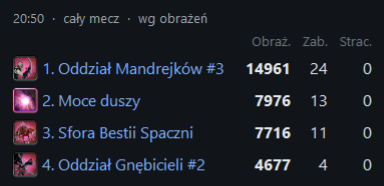

# DoW – statystyki powtórek (Dawn of War: Definitive Edition)

Statystyki oddziałów z powtórek **Dawn of War: Definitive Edition**, podobne do tych w powtórkach StarCrafta II.
Dla każdego oddziału liczy zadane obrażenia, zabite modele, otrzymane obrażenia i stracone modele, z podziałem na
bronie, granaty i zdolności (moce duszy Mrocznych Eldarów jako osobny wiersz). Dane pokazuje okno podglądu oraz
półprzezroczysta nakładka na grę. Po kliknięciu oddziału w grze widać jego statystyki.

Interfejs: **polski, angielski, rosyjski** · UI: **Polish, English, Russian** · Интерфейс: **польский, английский, русский**

## Pobranie i użycie (dla graczy)

1. Pobierz `DoW-Statystyki-<wersja>.zip` z zakładki **[Releases](../../releases)** i rozpakuj.
2. Uruchom **`Start.bat`**, w grze otwórz **Powtórki → powtórka → Odtwórz**.
3. Szczegóły: `INSTRUKCJA.txt` w paczce.

Wymagania: Windows 10/11 64-bit, DoW: Definitive Edition ze Steam (wersja 2.10.3.1). Nic więcej nie trzeba instalować.

### Nakładki i co oznaczają liczby

- **Nakładka oddziału** – oddział zaznaczony w grze: obrażenia, zabite i stracone modele, zniszczona i stracona
  wartość. **Nakładka podsumowania** – zakładki poniżej (pojedyncze zakładki można wyłączyć w ustawieniach).
- Skróty (działają w grze, do zmiany w Nakładka…): **F6** pokaż/ukryj nakładkę oddziału, **F7** pokaż/ukryj
  podsumowanie, **F8** następna zakładka.
- **R** – rekwizycja, **E** – energia.
- **Armia** – drużyna po lewej, drużyna po prawej; gracz z frakcją i jego najlepsze oddziały w całym meczu.
- **Straty** – stracone modele i budynki z ikonami oraz ich wartość. Wartość to **faktycznie wydane** zasoby:
  model kupiony razem z oddziałem ma cenę modelu, dokupiony później – koszt uzupełnienia, lider – swoją cenę;
  do modelu doliczana jest płatna broń, której użył (broń kupiona, ale nieużyta, nie jest widoczna). Anulowana
  budowa (gra zwraca zasoby) i budynki usunięte po przegranej nie są stratą.
- **Ekonomia** – stan zasobów, dochód na minutę, zebrane łącznie (bez zasobów startowych) i wykresy przewagi
  dochodu osobno dla rekwizycji i energii.
- **Ulepszenia** – ukończone badania z czasem; badania ekonomiczne (więcej rekwizycji/energii) na zielono.
- **Budowa** – kiedy gracz pierwszy raz wystawił dany typ jednostki lub postawił budynek (budynki na złoto);
  przewijanie kółkiem myszy, gdy nakładka jest odblokowana.
- **Bitwy** – aktualna wartość armii (żywe jednostki, bez budynków; faktycznie wydane jak w Stratach), wykres
  przewagi wartości armii oraz bitwy: okresy z największymi obrażeniami, obrażenia i straty każdej drużyny
  (pogrubione – mniejsze straty w tej bitwie).
- Drużyny pochodzą z gry (sojusznik/wróg); frakcja gracza – z jego jednostek.

## English

Squad statistics for **Dawn of War: Definitive Edition** replays, similar to StarCraft II replay stats: damage dealt,
models killed, damage taken and models lost for every squad, split by weapons, grenades and abilities (Dark Eldar
soul powers as a separate row). A viewer window and a semi-transparent in-game overlay; selecting a squad in the
game shows its numbers. Download the zip from **[Releases](../../releases)**, extract, run **`Start.bat`**, then
in the game: Replays → choose a replay → Play. Details: `INSTRUCTIONS_EN.txt`. Works only while watching replays;
game files are not modified.

Summary overlay tabs (F7 show/hide, F8 next tab, F6 squad overlay): Army, Losses, Economy, Upgrades, Build order,
Battles. R = requisition, P = power. Losses and army value count **resources actually spent**: models bought with
the squad at model cost, later ones at reinforcement cost, leaders at their own cost, plus paid weapons the model
used; cancelled construction (refunded) and buildings removed after defeat are not losses. Army value = living
units without buildings. Battles = periods with the most damage (bold = smaller losses in that battle).

## Русский

Статистика отрядов в реплеях **Dawn of War: Definitive Edition**, как в реплеях StarCraft II: нанесённый урон,
убитые модели, полученный урон и потери каждого отряда с разбивкой по оружию, гранатам и способностям (силы душ
Тёмных эльдар отдельной строкой). Окно просмотра и полупрозрачный оверлей поверх игры; при выборе отряда в игре
показывается его статистика. Скачайте zip из **[Releases](../../releases)**, распакуйте, запустите **`Start.bat`**,
затем в игре: Реплеи → выберите реплей → Воспроизвести. Подробности: `INSTRUKCIYA_RU.txt`. Работает только при
просмотре реплеев; файлы игры не изменяются.

Вкладки сводки (F7 показать/скрыть, F8 следующая вкладка, F6 оверлей отряда): Армия, Потери, Экономика, Улучшения,
Порядок стройки, Битвы. Р – реквизиция, Э – энергия. Потери и стоимость армии считаются как **фактически
потраченные** ресурсы: модели, купленные с отрядом, – по цене модели, добавленные позже – по цене пополнения,
лидеры – по своей цене, плюс использованное платное оружие; отменённая стройка (ресурсы возвращаются) и здания,
удалённые после поражения, не считаются потерями. Стоимость армии – живые юниты без зданий. Битвы – периоды с
наибольшим уроном (жирным – меньшие потери в этой битве).

## Jak to działa

- Plik powtórki `.rec` zawiera tylko komendy graczy, a gra liczy bitwę od nowa przy odtwarzaniu. Dlatego
  rejestrator (`dowrec.dll`) działa **w grze** podczas odtwarzania. Podpina się (MinHook) pod funkcję nakładania
  obrażeń (atakujący, ofiara, broń/zdolność), zmianę zdrowia i śmierć modelu, a adresy znajduje wzorcami bajtów.
  Zdarzenia zapisuje do `recordings/*.jsonl`.
- Launcher uruchamia grę i wstrzykuje rejestrator. **Pliki gry nie są modyfikowane.** Rejestrator działa tylko
  przy odtwarzaniu powtórek i sam wyłącza się w meczu na żywo. Do gier sieciowych uruchamiaj grę normalnie przez Steam.
- Podgląd i nakładka (Python/tkinter) czytają nagranie na bieżąco. Polskie nazwy jednostek i zdolności pochodzą
  z plików gry gracza (archiwa SGA, pliki RGD, `Engine.ucs`), zbieranych przy pierwszym uruchomieniu.

## Dla programistów

| Folder | Zawartość |
|---|---|
| `probe/` | rejestrator `recorder.cpp`, sonda diagnostyczna `probe.cpp`, launcher, `build.bat` (MSVC) |
| `viewer/` | podgląd `dow_viewer.py`, nakładka `overlay.py`, model danych `recmodel.py` |
| `catalog/` | czytniki SGA v2 i RGD, budowa katalogu nazw `build_catalog.py` |
| `package/` | paczka dla graczy: `make_package.py` (PyInstaller), `Start.bat`, `INSTRUKCJA.txt` |
| `analysis/` | skrypty analizy statycznej i diagnostyki |
| `NOTES.md` | wszystkie ustalenia: adresy, formaty, co jest potwierdzone, a co jest hipotezą |

Uruchamianie z kodu: `start.bat` (wymaga Visual Studio Build Tools i Pythona 3).
Budowa paczki: `.venv\Scripts\python package\make_package.py` (wymaga `pip install pyinstaller` w `.venv`).

Narzędzie nieoficjalne, niezwiązane z Relic Entertainment ani SEGA. Używa [MinHook](https://github.com/TsudaKageyu/minhook)
(licencja BSD, `third_party/minhook/LICENSE.txt`).
